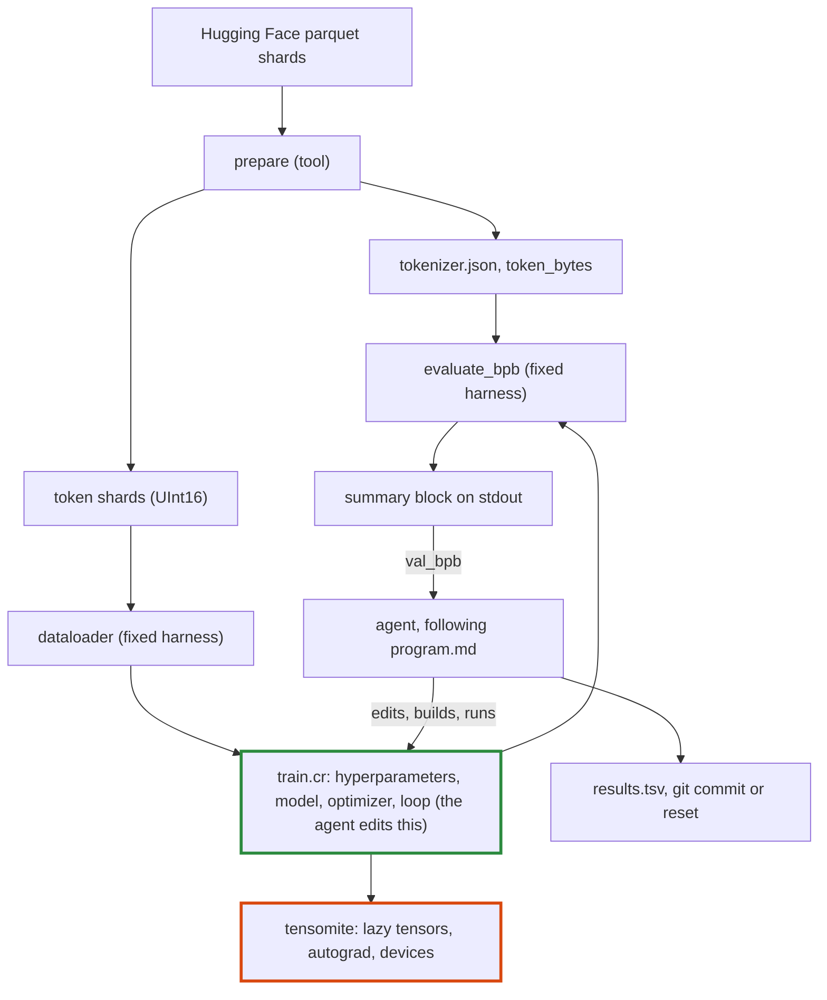
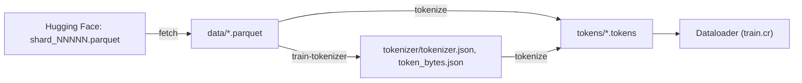

# `autoresearch.cr` design

This document says how the application is put together and why. Read [README.md](README.md) for what it does from the outside, [SCOPE.md](SCOPE.md) for the goal and [PLAN.md](PLAN.md) for the order of work. It describes the design as planned; sections change as milestones land.

## The problem in one paragraph

`autoresearch` lets a language model do research on a small language model. The model edits one training script, trains for exactly five minutes of wall-clock time, and the script reports one number, bits per byte on a held-out set. If the number fell, the edit is kept; if not, it is reverted. Because the budget is time, not steps, a change that is slower per step but better per second still wins, and the loop finds the best model for the machine it runs on. This repo does the same on tensomite. What has to be exact is the contract (one editable file, one fixed harness, one metric); what may differ is speed and precision.

## Shape of the system



Green is the one file the agent may change. Orange is the library this project exists to test. Everything between them is fixed.

## Repository layout

```
train.cr                   the editable file: constants, model, optimizer, loop, main
src/autoresearch/
  constants.cr             fixed: sequence length, time budget, eval tokens, vocabulary, pattern, cache paths
  shards.cr                fixed: token shard format, reader and writer
  tokenizer.cr             fixed: the trained tokenizer and token byte lengths
  dataloader.cr            fixed: best-fit packing, train and validation split
  evaluate.cr              fixed: evaluate_bpb (M4)
tools/
  prepare.cr               the prepare tool's commands
  prepare/                 fetch, train_tokenizer, tokenize; parquet, thrift, zstd; bpe_trainer, tokenizer_files
  batch_digests.cr         digests of the first batches, for make check-data
scripts/fixtures/          Python: makes the reference fixtures (the only Python here)
bench/                     benchmarks, such as the optimizer step against a training step
spec/                      parity specs and fixtures
spikes/                    the spike, until absorbed (see PLAN.md)
program.md                 the agent's instructions
```

Two programs come out of `make build` for use, `bin/prepare` and `bin/train`, beside `bin/batch_digests` for checking and the spike. The split of `train.cr` from `src/autoresearch/` is the original's split of `train.py` from `prepare.py`, and `program.md` tells the agent the same rules: edit the one, never the other.

## Behaviours of the original to preserve

These come from reading `train.py` and `prepare.py`; each is a place a port can quietly go wrong, and each has a fixture check in the plan.

| Area | Original | Note for the port |
|---|---|---|
| Sizes | `model_dim = ceil(depth × 64 / 128) × 128`; heads = `model_dim / 128` | At depth 8: width 512, 4 heads, 50.3 M parameters |
| Attention | RoPE on q and k, then RMSNorm on q and k; window `S` is half the context, `L` full; the last layer is always `L`; FlashAttention's window is inclusive, so `S` sees `T/2 + 1` keys | Pattern `SSSL`; windowed as a mask (`0 <= i - j <= window`) until tensomite has fused attention |
| RoPE | `y1 = x1·cos + x2·sin`, `y2 = −x1·sin + x2·cos` | Tensomite rotates the other way; pass `−sin` |
| Value embeddings | On alternating layers, the last always included; gate `2·sigmoid(W·x[:32])` per head | Gate weights start at zero (neutral) |
| Residual scalars | `x = λ_resid[i]·x + λ_x0[i]·x0` | `λ_resid` starts at 1, `λ_x0` at 0.1 |
| MLP, head | ReLU², no biases; logits `15·tanh(x/15)` | |
| Initial weights | Embedding normal(1); head normal(0.001); matrices uniform ±√3/√width; output projections zero | The original casts embeddings and rotary tables to BF16; fixtures drop that |
| Optimizer groups | Head, token embedding, value embeddings, two scalar groups (Adam, ε = 1e-10, different learning rates and betas); Muon for each matrix shape | Head and embedding learning rates scaled by `(width/768)^-½`; Muon rate times `max(1, rows/cols)^½` |
| Muon | Nesterov momentum; five Newton–Schulz steps with fixed coefficients; NorMuon variance scaling; cautious weight decay | Written for `[out, in]` weights; tensomite stores `[in, out]` |
| Schedules | By progress through the time budget: warm-up 0, warm-down half, final fraction 0; momentum 0.85 to 0.95 over 300 steps; decay falls linearly to zero | |
| Loop | Gradient accumulation to 2^19 tokens; the first ten steps do not count toward the budget; EMA loss with bias correction; fail fast on NaN or loss above 100 | |
| Tokenizer | Vocabulary 8,192; GPT-4-style split with `\p{N}{1,2}` and possessive quantifiers; four reserved special tokens; BOS is the first | Needs tensomite's BPE pattern option |
| Packing | Rows of `T+1` tokens, each starting with BOS; take the largest buffered document that fits, otherwise crop the shortest; no padding | Buffer of 1,000 documents |
| Metric | Sum of per-token nats over the validation tokens, divided by `ln 2 ×` the sum of target token byte lengths; special tokens count zero | Validation shard is pinned (the last); 40 × 2^19 tokens |

## Training

`train.cr` has the original's order, so an agent that knows `train.py` knows it:

1. Constants: the hyperparameters, depth, device batch size, profile.
2. `GPT` and its parts, as `Tensomite::Module`s. Parameters are found by instance variable, so adding one is adding a field.
3. `MuonAdamW`, all of it in `train.cr` as in `train.py`, Newton–Schulz included (Decision E): an `Optimizer` that overrides `updates` to step Adam groups per parameter and Muon groups stacked by shape, and keeps its state through `keep`, so `state`, `restore` and buffer release work as for tensomite's own.
4. The loop.
5. `main`, behind a compile flag so specs can load the rest (Decision C).

Memory and speed follow from three tensomite behaviours the loop must respect:

- **Tensors are lazy and immutable.** A step realises the loss and gradients together. With gradient accumulation, each micro-batch's gradients are realised with `release: true` before the next begins, then summed; otherwise every micro-batch's activations stay alive. The spike confirmed this works and matches a single large batch.
- **A tensor is limited to 8 GiB.** The reference micro-batch of 128 makes a logits tensor of exactly 8 GiB (128 × 2,048 × 8,192 floats), at the limit, so the reference profile uses 64 sequences per micro-batch or fewer.
- **Windowed attention is a mask** until tensomite has fused training attention. It computes the full `T×T` scores, so memory and time grow with `T²`; the scaled-down profile's shorter sequence avoids the cost.

## Data

`prepare` has three commands that mirror `prepare.py`'s steps, each resumable. Everything goes under the cache directory, `AUTORESEARCH_CACHE` or `~/.cache/autoresearch.cr`: `data/` for Parquet shards, `tokenizer/`, and `tokens/`.



1. `fetch` downloads the first `--num-shards` training shards (10 by default) and the validation shard, 8 at a time. It retries each up to 5 times, writes to `.tmp` and renames, and skips shards already present.
2. `train-tokenizer` takes the training shards' documents in order, each cut to 10,000 characters, until 1 billion characters. It counts the chunks the split pattern makes, and trains 7,932 merges as `rustbpe` 0.1.0 does: the most frequent pair first, ties to the smaller pair, left to right without overlap. It writes `tokenizer.json`, which tensomite's `BPE.from_json` reads, and `token_bytes.json`, each token's UTF-8 length after decoding with errors replaced, as `prepare.py` measures it (a lone `0x80` counts 3).
3. `tokenize` encodes every document with tensomite's `BPE`, special tokens as text, BOS first, and writes one token shard per Parquet shard (`Autoresearch::TokenShard`): a header, documents per row group, document offsets, `UInt16` tokens.

**The shards' layout.** Inspected at M3, shards 0 and 6542 hold one optional string column, `text`, written by Arrow 21. Each row group (1,024 rows) has one ZSTD-compressed v1 data page of PLAIN byte arrays, with no dictionary and no nulls. The reader handles that layout and raises, naming what it met, for anything else, so a shard laid out differently fails loudly. ZSTD comes from the system's libzstd through a small binding (Decision J), used only by `bin/prepare`.

**Tokenising ahead of time** is a departure from the original, which tokenises while training. It keeps Parquet, ZSTD and the trainer out of the training binary, so the agent's rebuilds stay short, and it takes tokenisation off the training path. The fixtures check that the ids equal the original's.

**The dataloader** memory-maps the token shards and packs rows exactly as `make_dataloader` does:
- It refills a buffer of documents to at least 1,000, in batches of up to 128 that never cross a Parquet row group. That is why token shards keep the row groups.
- Each row starts with a document's BOS, and takes the longest buffered document that fits the space left, the first on ties.
- When nothing fits, it crops the shortest document and drops the rest of it.
- When the shards run out, a new epoch starts.

It is deterministic and builds each batch on demand. It does not prefetch yet; M4 adds that if the loader shows in a profile.

## Evaluation

`evaluate_bpb` is in the fixed harness. It runs the model over the validation tokens in micro-batches, takes per-token losses (`cross_entropy(reduction: :none)`), weights each by its target's byte length and divides as in the table above. It is outside the training budget, as in the original, and is tested against the fixture to four significant digits.

## Devices and builds

The device is chosen by flag: `cpu` is tensomite's naive oracle, kept for parity checks, and is too slow to train on; `blas` is the host path; `cuda` and `metal` are the GPU paths. The GB10 (CUDA) carries long runs and reference numbers; the M5 Pro (Metal) is supported on equal terms, with every GPU exit shown on both (PLAN, Decision I). Runs use `crystal build --release`, which on a 2-core container built the spike in 27 s and ran about 2.5 times faster than `-O3`; the agent's loop is "edit, build, run".

## Testing

- **Parity specs** compare the port with committed fixtures: model loss and gradients, optimizer updates, token ids, batches, `val_bpb`. Tolerances are written next to each check.
- **Fixtures** are made once by `scripts/fixtures/` with a pinned PyTorch, on CPU in `F32`, with the original's BF16 casts removed and FlashAttention replaced by `scaled_dot_product_attention` with the same window mask. The substitutions are listed in the fixtures' README. CI needs no Python or GPU.
- **Specs pin the baseline.** They test `train.cr` as committed at the baseline tag. An agent's branch changes the file and is expected to diverge; the specs are not part of its loop.
- **Device parity.** Where a GPU is present, the same specs run against it, as tensomite's do.

## Open questions

1. The scaled-down profile: dataset, sequence length, depth (Decision H).