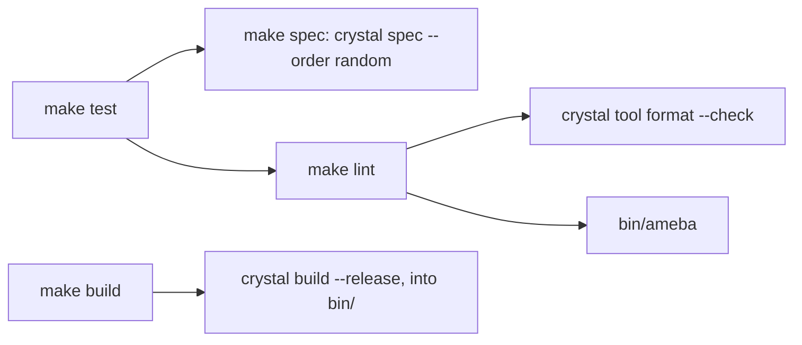

# Developing `autoresearch.cr`

How to build, test and change this app. For how it works, see [DESIGN.md](DESIGN.md); for the order of work, [PLAN.md](PLAN.md).

## Setup

1. **Install Crystal 1.22 or later**, which includes `shards`: `brew install crystal` on macOS or Linux, or [install Crystal](https://crystal-lang.org/install/) from the website.
2. **Install a BLAS library** for tensomite's `BLAS` device, which runs every model here. macOS has Accelerate already. On Debian or Ubuntu:
   ```bash
   sudo apt-get install libopenblas-dev
   ```
3. **Install the shards and build the linter:**
   ```bash
   make deps
   ```
   This runs `shards install` against the committed `shard.lock`, then compiles ameba into `bin/ameba`.

## Everyday commands

`make` is the interface. CI calls the same targets, so a clean `make test` locally means a clean CI run, give or take the platform.

| Task | Command |
|---|---|
| Install shards and build the linter | `make deps` |
| Run the specs, in random order | `make spec` |
| Check formatting and lint | `make lint` |
| Fix formatting | `make format` |
| Build the programs into `bin/` | `make build` |
| Everything before a PR | `make test` (specs, then lint) |
| Remove built programs | `make clean` |



`make test` must be clean before a PR.

**Variables.** `make` takes overrides on the command line:

- `SPEC_FLAGS` (default `--order random`). A random-order run ends with `Randomized with seed: N`; replay it with `make spec SPEC_FLAGS="--order N"`.
- `BUILD_FLAGS` (default `--release`). Use `make build BUILD_FLAGS=` for a faster debug build while iterating.

## Building

`make build` builds every program in release mode. At M0 that is the spike only, `bin/gpt_spike`; from M3 and M4 it adds `bin/prepare` and `bin/train` (see "Repository layout" in DESIGN.md).

Runs that measure anything use a release build. On a 2-core container `--release` builds the spike in about 27 s and runs it about 2.5 times faster than `-O3`. That build time is part of every experiment the agent runs, so `train.cr` stays free of heavy macros.

## Devices

A device is where tensomite stores tensors and runs kernels. Tensomite is `F32`-only for now, and one tensor is limited to 2 GiB.

| Device | What it is | Use here |
|---|---|---|
| `BLAS` | host memory, matrix products through OpenBLAS or Accelerate | the default for anything that runs a model, specs included |
| `CPU` | pure-Crystal kernels, naive and slow | an oracle for checking a single op; never for training |
| `CUDA` | NVIDIA GPUs, in a build with `-Dcuda` and `require "tensomite/cuda"` | GPU parity specs and runs, from M1 |
| `Metal` | Apple Silicon GPUs, with `require "tensomite/metal"` | GPU parity specs and runs, from M1 |

The spike hard-codes `BLAS`. `train` will take `--device cpu|blas|cuda|metal` (PLAN M4). A CUDA build passes the flag through `BUILD_FLAGS`, for example `make build BUILD_FLAGS="--release -Dcuda"`.

**High system time is OpenBLAS, not the collector.** OpenBLAS's worker threads busy-wait between calls, so `time` reports several times the wall time as `user` and `sys`. `OPENBLAS_NUM_THREADS=1` removes it, at little cost for models this small.

## Continuous integration

`.github/workflows/ci.yml` runs on every push to `main` and every pull request, on Linux (OpenBLAS) and macOS (Accelerate), with Crystal pinned to the minimum in `shard.yml`. Each job runs `make deps`, `make test` and `make build`, then trains the spike for 20 steps as a smoke test. `lib/` and `bin/ameba` are cached, keyed on the OS, the Crystal version and `shard.lock`.

To change dependencies, edit `shard.yml`, run `shards update` (or `shards install` for a new shard), and commit both files. `shard.lock` is committed so every machine, CI included, builds against the same versions.

## Optional: `ops`

[`ops`](https://github.com/nickthecook/ops) is a convenience wrapper. Each action in `ops.yml` calls a `make` target, so nothing is available only through `ops`; actions that are not `make` calls may be added later.

| `ops` | Runs |
|---|---|
| `ops up` | `brew install crystal`, then `make deps` |
| `ops spec` | `make spec` |
| `ops lint` | `make lint` |
| `ops build` | `make build` |
| `ops test` | `make test` |
| `ops run FILE` | `crystal run FILE` |
| `ops wipe` | `crystal clear_cache` |

`ops up` expects Homebrew for Crystal. Without it, install Crystal as in Setup and use `make deps`.

## Layout

```
Makefile                 deps, spec, lint, format, build, test, clean
shard.lock               pinned dependency versions, committed
.github/workflows/ci.yml make deps, test and build on Linux and macOS
ops.yml                  optional ops actions, each a make call
.ameba.yml               lint configuration; lib/, bin/ and spikes/ are excluded
spec/spec_helper.cr      requires tensomite and its BLAS device; DEVICE, tensor, expect_close
spec/*_spec.cr           specs; each milestone's exit has a `describe "Mn exit: …"` block
spikes/gpt_spike.cr      the spike, until its pieces are absorbed (PLAN, "Bringing in the spike")
```

DESIGN.md's "Repository layout" shows where `train.cr`, `src/autoresearch/`, `tools/` and `scripts/fixtures/` will go.

## Conventions

### Code

- **Comments document the API and its outcomes:** what a type is, what a method returns or does. Inside a function, a comment lists the steps of the algorithm. No history: that goes in commit messages, and in PLAN.md when it matters to future contributors.
- **Diagrams are Mermaid.**
- **Library gaps go upstream.** If tensomite lacks something, open an issue there with a minimal reproduction and link it from PLAN.md. Do not work around it here.
- **The spike stays verbatim.** `spikes/` is excluded from formatting and lint; code that leaves it for `train.cr` meets both.

### Specs

- **Specs run models on `DEVICE` (BLAS).** The CPU oracle is for single-op checks only.
- **Parity specs compare with committed fixtures** made from the PyTorch original, with the tolerance written next to each check and the reason for it.
- **Hand-computed expected values** carry their arithmetic in a comment above the assertion, as in `spec/foundation_spec.cr`.

## Contributions

By invitation only for the time being.
