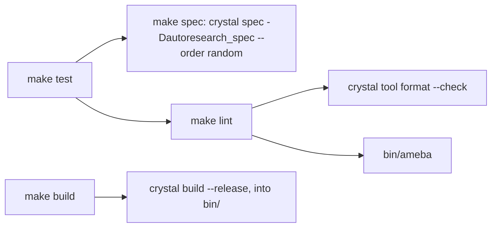

# Developing `autoresearch.cr`

How to build, test and change this app. For how it works, see [DESIGN.md](DESIGN.md); for the order of work, [PLAN.md](PLAN.md).

## Setup

1. **Install Crystal 1.22 or later**, which includes `shards`: `brew install crystal` on macOS or Linux, or [install Crystal](https://crystal-lang.org/install/) from the website.
2. **Install a BLAS library and libzstd.** The BLAS library is for tensomite's `BLAS` device, which runs every model here. libzstd is for `bin/prepare`, which decompresses the dataset's Parquet shards with it (Decision J). macOS has Accelerate already. On Debian or Ubuntu:
   ```bash
   sudo apt-get install libopenblas-dev libzstd-dev
   ```
   On macOS:
   ```bash
   brew install zstd pkgconf
   ```
   `pkgconf` lets the linker find Homebrew's libzstd.
3. **Install the shards and build the linter:**
   ```bash
   make deps
   ```
   This runs `shards install` against the committed `shard.lock`, then compiles ameba into `bin/ameba`.

## Everyday commands

`make` is the interface. CI calls the same targets, so a clean `make test` locally means a clean CI run, give or take the platform.

| Task | Command |
|---|---|
| Install shards and build the linter | `make deps` |
| Run the specs, in random order | `make spec` |
| Run the specs with the CUDA device too | `make spec CUDA=1` |
| Check formatting and lint | `make lint` |
| Fix formatting | `make format` |
| Build the programs into `bin/` | `make build` |
| Everything before a PR | `make test` (specs, then lint) |
| Remove built programs | `make clean` |
| Regenerate the fixtures | `make fixtures` |
| Prepare the data | `bin/prepare` (after `make build`) |
| Check prepared data against `prepare.py` | `make check-data` |
| Time the optimizer against a training step | `make bench` (`DEVICE=`, `BATCH=`) |
| Profile training steps on a GPU | `make profile DEVICE=cuda\|metal` (`BATCH=`, `STEPS=`, `SEQ=`, `DEPTH=`) |



`make test` must be clean before a PR.

**Variables.** `make` takes overrides on the command line:

- `SPEC_FLAGS` (default `--order random`). A random-order run ends with `Randomized with seed: N`; replay it with `make spec SPEC_FLAGS="--order N"`.
- `BUILD_FLAGS` (default `--release`). Use `make build BUILD_FLAGS=` for a faster debug build while iterating.
- `CUDA` (default empty). `CUDA=1` builds specs and programs with `-Dcuda`, so the CUDA device is linked and used.

**Why `-Dautoresearch_spec`.** Specs `require "../train"` to test its model. `train.cr` ends with `main` inside ``, so the flag stops a spec run from training (Decision C). `spec_helper.cr` refuses to compile without it, so a bare `crystal spec` fails at once with a message saying to use `make spec`, rather than starting a run.

## Building

`make build` builds every program in release mode: `bin/train` from `train.cr`, and the spike, `bin/gpt_spike`. At M1 `bin/train` builds the depth-8 model and prints its configuration, parameter counts and FLOPs per token, as `train.py` does before it trains; the loop arrives in M4, and `bin/prepare` in M3.

Runs that measure anything use a release build. On a 2-core container `--release` builds the spike in about 27 s and runs it about 2.5 times faster than `-O3`. That build time is part of every experiment the agent runs, so `train.cr` stays free of heavy macros.

## Devices

A device is where tensomite stores tensors and runs kernels. Tensomite is `F32`-only for now, and one tensor is limited to 8 GiB.

| Device | What it is | Use here |
|---|---|---|
| `BLAS` | host memory, matrix products through OpenBLAS or Accelerate | the default for anything that runs a model, specs included |
| `CPU` | pure-Crystal kernels, naive and slow | an oracle for checking a single op; never for training |
| `CUDA` | NVIDIA GPUs, in a build with `-Dcuda` (`CUDA=1`) | parity specs on the GB10, and long runs from M4 |
| `Metal` | Apple Silicon GPUs, always compiled in on an Apple Silicon Mac | parity specs on the M5 Pro, and runs from M4 |

**GPU parity.** The parity specs run on `BLAS` and on each GPU in `GPUS` (`spec/spec_helper.cr`): Metal when the Mac has one, CUDA in a `CUDA=1` build with a GPU. Hosted CI has neither, so every GPU exit is shown by running, and pasting into the PR:

- on the M5 Pro: `make spec`, whose output names `on Tensomite::Metal`
- on the GB10: `make spec CUDA=1`, whose output names `on Tensomite::CUDA`

`train` hard-codes `BLAS` until it takes `--device cpu|blas|cuda|metal` (PLAN M4); so does the spike.

**High system time is OpenBLAS, not the collector.** OpenBLAS's worker threads busy-wait between calls, so `time` reports several times the wall time as `user` and `sys`. `OPENBLAS_NUM_THREADS=1` removes it, at little cost for models this small.

## Benchmarks

`bench/optimizer_step.cr` times one `MuonAdamW` step on the depth-8 model against a training step of `train.py`'s 2^19 tokens. It times forward and backward on one micro-batch and scales that to 2^19 tokens, since a full step is too slow to time on the host.

```bash
make bench
```

`DEVICE` picks `blas` (the default), `metal` or `cuda`; `BATCH` sets the micro-batch's sequences (default 1). For example, on the GB10:

```bash
make bench CUDA=1 DEVICE=cuda BATCH=8
```

On the M5 Pro:

```bash
make bench DEVICE=metal BATCH=8
```

`bench/profile_step.cr` profiles training steps on a GPU and prints tensomite's per-op report: where a step's time goes, by op and shape. It runs three warm-up steps, then `STEPS` timed as they run, then `STEPS` more with each op timed alone. A step is one micro-batch, forward and backward, plus the optimizer step. `SEQ` and `DEPTH` change the model's shape. On the GB10:

```bash
make profile CUDA=1 DEVICE=cuda BATCH=8
```

On the M5 Pro:

```bash
make profile DEVICE=metal BATCH=8
```

`make profile CUDA=1 DEVICE=cuda BATCH=8 SEQ=512` profiles a shorter context for comparison.

## Preparing data

`bin/prepare` (`tools/prepare.cr`) fills the cache, `AUTORESEARCH_CACHE` or `~/.cache/autoresearch.cr`. Its commands run in order:

| Command | What it does | Time and size (default 10 training shards, four cores) |
|---|---|---|
| `bin/prepare fetch` | downloads `data/shard_NNNNN.parquet` | about 1 GB; minutes, depending on the network |
| `bin/prepare train-tokenizer` | writes `tokenizer/tokenizer.json` and `token_bytes.json` | about 60 s |
| `bin/prepare tokenize` | writes `tokens/shard_NNNNN.tokens` | about 23 s and 127 MB per shard |
| `bin/prepare` | all three | |

`--num-shards N` (-1 for all 6,542) and `--download-workers N` work as in `prepare.py`. Each step skips finished work, so an interrupted run resumes. To start over, delete the cache directory or the part to redo.

`make check-data` compares the cache with `prepare.py` itself, at the pinned commit, on the same shards. It trains `prepare.py`'s tokenizer into `reference/` and compares every token, every document's ids and the first 50 batches of each split, then prints one line per check. It needs Python, as `make fixtures` does, and takes tens of minutes.

## Continuous integration

`.github/workflows/ci.yml` runs on every push to `main` and every pull request, on Linux (OpenBLAS) and macOS (Accelerate), with Crystal pinned to the minimum in `shard.yml`. Each job runs `make deps`, `make test` and `make build`, then trains the spike for 20 steps as a smoke test. `lib/` and `bin/ameba` are cached, keyed on the OS, the Crystal version and `shard.lock`.

## Fixtures

Parity specs compare `train.cr` with outputs of the PyTorch original, committed under `spec/fixtures/`; spec/fixtures/README.md says what each holds and every substitution made. To regenerate them:

```bash
make fixtures
```

It needs Python 3 (3.13 is used; PyTorch must publish wheels for it) and the network. `scripts/fixtures/regenerate.sh` fetches `karpathy/autoresearch` at the pinned commit and creates a virtual environment from `scripts/fixtures/requirements.txt`, both under `scripts/fixtures/.cache/` (git-ignored), then runs `make_fixtures.py`. The first run takes a few minutes, mostly downloading PyTorch; the output is byte-identical between runs, so `git status` after it should show no change.

To change dependencies, edit `shard.yml`, run `shards update` (or `shards install` for a new shard), and commit both files. `shard.lock` is committed so every machine, CI included, builds against the same versions.

## Optional: `ops`

[`ops`](https://github.com/nickthecook/ops) is a convenience wrapper. Each action in `ops.yml` calls a `make` target, so nothing is available only through `ops`; actions that are not `make` calls may be added later.

| `ops` | Runs |
|---|---|
| `ops up` | `brew install crystal`, then `make deps` |
| `ops spec` | `make spec` |
| `ops lint` | `make lint` |
| `ops build` | `make build` |
| `ops test` | `make test` |
| `ops run FILE` | `crystal run FILE` |
| `ops wipe` | `crystal clear_cache` |

`ops up` expects Homebrew for Crystal. Without it, install Crystal as in Setup and use `make deps`.

## Layout

```
train.cr                 the editable file: hyperparameters, model; optimizer and loop to come
src/autoresearch/        the fixed harness: constants.cr so far
Makefile                 deps, spec, lint, format, build, test, clean, fixtures, check-data, bench, profile
tools/prepare.cr         bin/prepare: fetch, train-tokenizer, tokenize
tools/prepare/           its parts: Parquet reader, libzstd binding, BPE trainer, tokenizer files
tools/batch_digests.cr   bin/batch_digests, for make check-data
shard.lock               pinned dependency versions, committed
.github/workflows/ci.yml make deps, test and build on Linux and macOS
ops.yml                  optional ops actions, each a make call
.claude/agents/          the implementer subagent's definition (see "Working with agents")
.ameba.yml               lint configuration; lib/, bin/ and spikes/ are excluded
spec/spec_helper.cr      requires train.cr and the devices; DEVICE, GPUS, MODEL_DEVICES, comparison helpers
spec/*_spec.cr           specs; each milestone's exit has a `describe "Mn exit: …"` block
spec/fixtures/           committed reference outputs, and their README
scripts/fixtures/        regenerate.sh, make_fixtures.py and its pinned requirements (the only Python)
bench/                   benchmarks, run in release mode with `make bench`
spikes/gpt_spike.cr      the spike, until its pieces are absorbed (PLAN, "Bringing in the spike")
```

DESIGN.md's "Repository layout" shows where the rest of `src/autoresearch/` and `tools/` will go.

## Conventions

### Code

- **Comments document the API and its outcomes:** what a type is, what a method returns or does. Inside a function, a comment lists the steps of the algorithm. No history: that goes in commit messages, and in PLAN.md when it matters to future contributors.
- **Diagrams are Mermaid.**
- **Library gaps go upstream.** If tensomite lacks something, open an issue there with a minimal reproduction and link it from PLAN.md. Do not work around it here.
- **The spike stays verbatim.** `spikes/` is excluded from formatting and lint; code that leaves it for `train.cr` meets both.

### Specs

- **Specs run models on `MODEL_DEVICES`:** `DEVICE` (BLAS) and any GPU present. The CPU oracle is for single-op checks only.
- **Parity specs compare with committed fixtures** made from the PyTorch original, with the tolerance written next to each check and the reason for it: what was measured, and what a broken implementation measured.
- **A fixture must be able to fail.** Before trusting one, break the code it checks (a sign, an index, an off-by-one) and see the spec fail; if it does not, change the fixture, as the model's did (spec/fixtures/README.md).
- **Hand-computed expected values** carry their arithmetic in a comment above the assertion, as in `spec/foundation_spec.cr`.

## Working with agents

Coding tasks may be delegated to `.claude/agents/implementer.md`, a subagent on a smaller model than the one directing the work. The agent that delegates keeps the design: it decides what to build, writes a brief naming the files, the change and how it will be accepted, and reviews the result before it goes into a commit. The implementer carries out the brief, runs `make test` and `make build`, and reports. It does not commit or decide.

Delegate when the task is mechanical and the brief is shorter than the work: a spec from stated expected values, a CLI flag, a formatter, a docs table, a bench. Keep in hand parity design, tolerances, diagnosis and anything whose difficulty is judgement. Choose the model per task: the definition's default, `sonnet`, for most; a smaller one for a trivial edit.

## Contributions

By invitation only for the time being.
