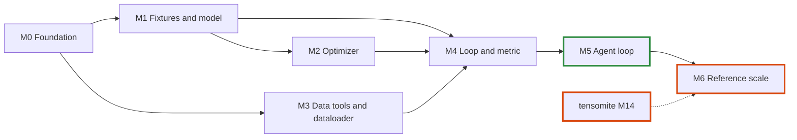

# `autoresearch.cr`: plan

Nov 21, 2026

See [SCOPE.md](SCOPE.md) for the goal and [DESIGN.md](DESIGN.md) for how the pieces fit.

## Principles

- **Parity before performance.** Each piece is checked against a fixture from the PyTorch original before it is built on.
- **Library gaps go upstream.** If the port strains tensomite, the fix is an issue and a PR there. This repo works around nothing it can ask for.
- **Always runnable.** Every milestone ends with something that builds, runs and has a measurable exit.
- **Scaled down first.** The reference size comes last, when tensomite's M14 allows it.
- **Evidence in the PR.** A milestone's exit is shown by logs or numbers in its PR, not asserted.

## Where the work is tracked

Tensomite's issues #156 to #176 were written for this port. A-01 to A-06 (tensomite#171 to #176) and the data-tool issues D-02 to D-05 are this repo's work: the A issues were deleted there and the D issues closed as won't-fix. The milestones below replace them, and each milestone's exit criteria carry the acceptance detail. The library issues (G-01 to G-09, D-01) and the epic (#156) stay in tensomite. New library gaps found along the way are opened in tensomite and linked from here.

| Gap | Found in | Tensomite | Here meanwhile |
|---|---|---|---|
| A `Module` silently ignores children held in a `Hash`, so a keyed collection such as `train.py`'s `value_embeds` cannot be expressed | M1 | [#188](https://github.com/nogginly/tensomite.cr/issues/188) | `value_embeds` is an `Array` in layer order; the fixture script maps the names |

| Here | Original key | Tensomite |
|---|---|---|
| M0 Foundation (done, #1) | | |
| M1 Reference fixtures and the model | A-01, A-02 | |
| M2 The optimizer | A-03 | G-02, G-03 (done in 0.8.0) |
| M3 Data tools and the dataloader | D-02 to D-05 | D-01 (done in 0.8.0) |
| M4 Training loop and metric | A-04, A-05 | G-05 (done), memory high-water mark (new) |
| M5 The agent loop | A-06 | G-09 (done) |
| M6 Reference scale | | G-01, G-07, G-08, fused cross-entropy (M14) |

## Order

M1 and M2 can run alongside M3: one needs Python and PyTorch, the other needs the network and the dataset. Green is the exit of the project (SCOPE's success criteria); orange depends on work outside this repo.

## Milestones

### M0: Foundation (done)

1. Add the `Makefile` that `ops.yml` calls (`spec`, `lint`, `build`, `test`), a spec helper, and an ameba configuration. `make` is the primary interface; `ops` wraps it as a convenience.
2. Commit the [spike](#bringing-in-the-spike) unchanged in logic, as the first commit after the foundation, under `spikes/`.
3. Fill in `README.md` and `DEVELOPMENT.md` (build, test, device flags, the `--release` build for runs).
4. Commit `shard.lock`, and add CI that runs `make test` and `make build` on Linux and macOS.

Exit: `make test` passes in CI on Linux and macOS, `make build` builds the spike, and the README's quick start works from a clean checkout.

### M1: Reference fixtures and the model

1. A script under `scripts/fixtures/` that runs the original's model on a tiny configuration with pinned PyTorch, on CPU in `F32`, and writes SafeTensors fixtures: weights, one batch, loss, per-parameter gradients, per-token losses. Substitutions (no BF16 casts, `scaled_dot_product_attention` with the same window mask in place of FlashAttention 3) are stated in the script and the fixtures' README.
2. The model in `train.cr`, from the spike, loaded from the fixture weights with `Module#load(transposed:)`.
3. Specs for loss, gradients and per-token loss, plus parameter counts and FLOPs per token against the original at depth 8.

Exit: loss and gradients match within the documented tolerance on CPU/BLAS, on CUDA (the GB10) and on Metal (the M5 Pro); counts equal the original's; fixtures regenerate from one command.

### M2: The optimizer

1. `MuonAdamW` in `train.cr`, from the spike, with the original's per-group settings and its schedules (learning-rate multiplier, momentum warm-up, weight-decay decay).
2. Fixtures: parameters after 1 and 5 steps from fixed gradients, with the schedule values used.
3. `state` and `restore` round-trip, so a run can resume.
4. Decide where Muon lives (Decision E).

Exit: updated parameters match the fixtures within tolerance; the optimizer step costs under a few percent of a training step at depth 8 (measured, recorded); Decision E recorded.

### M3: Data tools and the dataloader

1. **Inspect first.** Read real shards and record the Parquet codec, encodings and row-group sizes. That decides how large the reader is.
2. A `prepare` tool in this repo: `fetch`, `train-tokenizer`, `tokenize`, each resumable and each its own source file.
3. A Parquet string-column reader, and a BPE trainer, both inside the tool and neither in tensomite.
4. Token shards (documented format) and the token-bytes table.
5. A dataloader over the token shards with the original's best-fit packing, BOS-aligned rows, train and validation split.

Exit: token ids for the first documents equal what `prepare.py` produces; tokenizer merges equal `rustbpe`'s on a fixed corpus (or each difference is explained); batches equal `make_dataloader`'s; `prepare` re-runs without redoing finished work.

### M4: Training loop and metric

1. The loop in `train.cr`: gradient accumulation, time budget excluding the first ten steps, EMA loss, fast fail, the original's per-step line and summary block.
2. `evaluate_bpb` in the fixed harness, with a parity fixture.
3. A device flag (`--device cpu|blas|cuda|metal`); apps must choose, as tensomite's `finetune` does.
4. Peak memory for the summary: ask tensomite for a device high-water mark, and report `0.0` with a note until it exists.
5. A scaled-down profile (Decision H) with its own baseline numbers.

Exit: a scaled-down run finishes inside its budget on BLAS, the GB10 and the M5 Pro, and prints a block that `program.md`'s greps parse; `val_bpb` on the fixture batch equals the original's to four significant digits; two runs with one seed give identical losses.

### M5: The agent loop

1. `program.md` for Crystal: the original's loop, plus the build step, how to read compile errors, and a short tensomite API cheat-sheet.
2. A smoke test: an agent runs the loop on the scaled-down profile unattended, ten cycles at least, including one recovered compile error and one crash.

Exit: the cycles' `results.tsv`, the commit log and a short write-up (what worked, what confused the agent, what the cheat-sheet lacked) are committed. This is the project's success criterion.

### M6: Reference scale

Depends on tensomite's M14. On the GB10, run depth 8 and sequence 2,048, record tokens per second, memory and `val_bpb` against the original's, with every deviation stated. If M14 is not done, record what the scaled-down profile reaches and what blocks the rest.

Exit: a table of reference-scale results, or a written account of what blocks them.

## Bringing in the spike

The spike (`spike_gpt.cr`) is a 4-layer, 0.9 M-parameter model with the original's structure and a MuonAdamW built on tensomite 0.8's `updates` hook. On a toy task its loss fell from 5.545 to 0.0014 in 200 steps (its default), and accumulation matched a single batch at every printed step. It proves the pieces run; it does not prove they match.

1. **Commit it as it is** to `spikes/gpt_spike.cr`, changing only `require "./src/tensomite"` to `require "tensomite"` (and the BLAS require likewise). That commit is the provenance; later commits change it.
2. **Absorb it in pieces**, each at its milestone and checked by the fixtures: the model in M1, the optimizer in M2, the training-loop fragment (the accumulation path) in M4.
3. **Delete `spikes/`** when the last piece is absorbed. The history keeps it.

The spike's synthetic data, device constant, hard-coded sizes and hyperparameters do not carry over. The model, optimizer and accumulation code do, with these changes:

- Sizes come from a depth (`model_dim` rounded to a multiple of the head dimension), as in the original.
- `-sin` is passed to `rope`, as the spike does, with a comment saying why.
- Muon works on `[out, in]` copies of tensomite's `[in, out]` weights; the original's tall-or-wide choice, NorMuon axis and learning-rate scale depend on it.
- The RMSNorm epsilon is the original's (`Float32::EPSILON`), a named constant.
- The sliding window is inclusive, as FlashAttention's is: query `i` sees key `j` when `0 <= i - j <= window`. The spike's mask used `i - j < window`, one key short on every `S` layer; the M1 fixture fails on it.

## The original, pinned

The port follows [`karpathy/autoresearch`](https://github.com/karpathy/autoresearch) at commit `228791fb499afffb54b46200aca536f79142f117` (25 March 2026; `train.py` last changed in `ebf3578`). The fixture scripts fetch that commit and check the SHA-256 of `train.py` and `prepare.py`. Moving to a later commit is a deliberate change: update the pin, regenerate the fixtures, and port whatever changed.

## Decisions

Lettered as in tensomite; each is recorded here when made.

- **A. This repo is the application; tensomite stays the library.** Settled. Gaps go upstream.
- **B. One editable file, one fixed harness.** `train.cr` mirrors `train.py`; `src/autoresearch/` mirrors `prepare.py`. Settled.
- **C. Specs load `train.cr` through a compile flag.** Settled at M1. The file ends with `main` guarded by ``, so specs can require its model and optimizer without running it; `make spec` passes the flag and `spec_helper.cr` refuses to compile without it, so a bare `crystal spec` cannot start a run. Splitting model and optimizer into files the agent also edits would break the one-file contract; a run-time guard (an environment variable) would start training when forgotten.
- **D. Data preparation is a tool, and training reads token shards.** Settled (tensomite's Decision 1). Parquet and the BPE trainer stay out of the training binary and its compile time.
- **E. Where Muon lives.** Open. Recommended: the library carries a generic `Muon` and its Newton–Schulz function; this repo's `train.cr` carries the recipe's `MuonAdamW` (NorMuon, cautious decay, schedules), which the agent edits. The spike's Muon took about 90 lines on the existing hook, so either is cheap.
- **F. Python only for fixtures.** Settled. Fixtures are committed, so CI needs no Python.
- **G. `F32` until tensomite has BF16 compute.** Settled. Fixtures are made in `F32` with the original's BF16 casts removed.
- **H. Profiles.** Open. A `reference` profile (depth 8, sequence 2,048, vocabulary 8,192) and a scaled-down one chosen at M4 (candidates: the same data with sequence 512 and depth 4; or a smaller dataset). A profile is a compile-time flag that picks a constants set, with its own cache directory.
- **I. Reference machines.** Settled. The GB10 (DGX Spark, CUDA) carries long runs and the reference numbers from M4 on. The M5 Pro (Metal) is a supported device, not a fallback: every exit that runs a model on a GPU is shown on both, and the scaled-down profile has a baseline on each. Hosted CI has no GPU, so GPU evidence comes from runs on these two machines, pasted into the PR.

## Risks

| Risk | Effect | Mitigation |
|---|---|---|
| Parquet shards use a codec that needs a native decompressor | A larger M3, or an FFI dependency in the tool | Inspect first (M3 step 1); keep it in the tool; consider converting once with Python as a stopgap, clearly marked |
| PyTorch's CPU path differs numerically from the original's GPU path | Fixture tolerances too loose to catch a bug | Tolerances set per check from measured PyTorch CPU-versus-GPU differences; compare gradients, not only losses |
| Tensomite's speed makes the five-minute budget buy few tokens | Experiments too noisy to rank | Scaled-down profile; record tokens per step; longer budget as a profile setting |
| Crystal rebuilds add to every experiment | Fewer cycles overnight | Tensomite's measurement says acceptable; keep `train.cr` free of heavy macros; `--release` for runs |
| Agent unfamiliar with tensomite's API | Wasted cycles on compile errors | Cheat-sheet in `program.md`; the M5 write-up feeds it |
| Upstream M14 slips | M6 blocked | M6 is a stretch; M0 to M5 deliver the project |
| Tensomite is young and one-maintainer | API churn | Pin `~> 0.8.0`; upgrade deliberately |